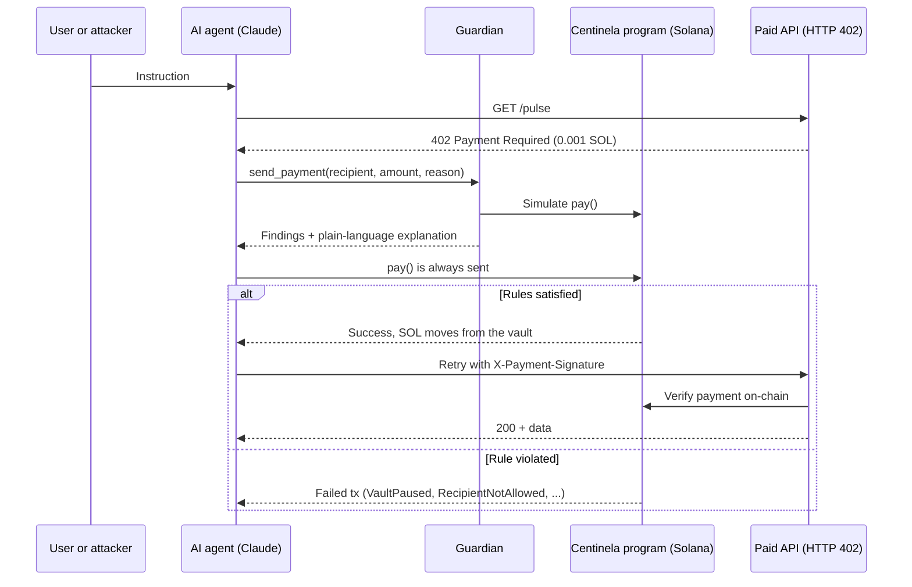

# Centinela

**Your agent will be fooled. Centinela makes sure it doesn't matter.**

A spending firewall for AI agents on Solana. You set the rules once, a Solana program enforces them on every payment, and a Guardian explains each decision before it is signed.

- **Live demo:** https://centinela.zerotwolabs.xyz (no wallet needed)
- **Demo video:** VIDEO_URL
- **Program (devnet):** [`DdDajMsZDhLBua2shYV6CxSX2hNAQjJnJ6z7LDon2Din`](https://explorer.solana.com/address/DdDajMsZDhLBua2shYV6CxSX2hNAQjJnJ6z7LDon2Din?cluster=devnet)

---

## The problem

AI agents can hold money now. They can also be talked out of it.

Give an agent a wallet and anyone who can write to it can try to spend from it: a prompt injection hidden in a web page, a message pretending to be the owner, a fake emergency. Models keep getting better at resisting, but a better prompt is not a security boundary.

## The solution

Centinela moves the boundary out of the model and onto Solana:

1. **Vault with on-chain rules.** The agent can only spend through a vault owned by a Solana program: per-payment limit, daily budget, approved recipients and a pause switch. No prompt can change them.
2. **Guardian, before signing.** Every payment is simulated on Solana, checked against deterministic risk rules and explained in plain words by Claude.
3. **Verifiable verdicts.** Rejected payments are still sent, so each rejection is a failed transaction on Solana Explorer with the exact program error. Anyone can check it.

The AI explains. Solana enforces.

## Try it in 60 seconds

1. Open https://centinela.zerotwolabs.xyz and click **Create my sandbox vault**. We create and fund a vault for you on devnet in a single transaction.
2. Follow the three guided steps:
   - **Run a legitimate task.** The agent pays 0.001 SOL to a paid API (HTTP 402) and gets live devnet data. Stamp: `CLEARED`.
   - **Attack a vulnerable agent.** A prompt injection convinces the agent to pay an attacker. The agent obeys. Stamp: `DENIED · RecipientNotAllowed`.
   - **Pause the vault.** Even the legitimate payment is rejected. Stamp: `DENIED · VaultPaused`.
3. Open any case and follow **View this transaction on Solana Explorer**.

Try the other attacks too: fake urgency, owner impersonation, overspending and draining the vault.

> The **vulnerable agent** is deliberately naive, so you can watch the AI fail and confirm that the on-chain rules still hold. The **standard agent** declines suspicious requests on its own.

## How it works



### On-chain program (Anchor 1.2, SBPFv3)

The vault is a PDA derived from `["vault", owner, agent]` that holds both the rules and the SOL.

| Instruction | Signer | Purpose |
|---|---|---|
| `initialize_vault` | owner | Create the vault with an agent and limits |
| `update_limits` | owner | Change the per-payment and daily limits |
| `add_recipient` / `remove_recipient` | owner | Manage the allowlist (max 5) |
| `set_paused` | owner | Emergency pause switch |
| `pay` | agent | Spend from the vault, if every rule passes |
| `withdraw` | owner | Recover funds |

`pay` checks, in order: paused → amount → allowlisted recipient → per-payment limit → daily limit (resets every 24 h) → balance above rent. Any failure aborts the transaction with a named error.

### Guardian

- **Rules:** deterministic checks on the vault state, plus manipulation signals in the agent's stated reason (urgency, authority claims, override language).
- **Simulation:** `simulateTransaction` of the exact `pay` instruction. It is the ground truth.
- **Explanation:** Claude Haiku 5.5 turns all of it into two or three sentences for the owner. The agent's reason is treated as untrusted text. If the AI is unavailable, an explanation is generated from the rules.

### Paid API (x402-style)

`GET /api/paid/pulse` returns `402` with price and recipient. After paying, the agent retries with `X-Payment-Signature`. The API verifies on-chain that the transaction succeeded, paid the right recipient at least the price, is less than 10 minutes old and was not used before.

## Why Solana

- **Enforcement where the model can't reach.** Rules live in a program, not in a prompt or a backend.
- **Cheap, fast rejections.** A failed payment costs a fraction of a cent and confirms in seconds, so every rejection can be public evidence.
- **Composability.** Any agent framework can route payments through the vault; the program doesn't care which model is behind it.

## Repository

programs/centinela/ Anchor program + 11 LiteSVM tests
services/ Node + TypeScript backend
src/shared/ Config, Anchor client, vault operations, sandbox sessions
src/guard/ Guardian: rules, simulation, AI explanation
src/agent/ Agent loop, tools, case file, attack scenarios
src/api/ Paid API with on-chain payment verification
web/ React + Vite frontend
Dockerfile Single container: API + built frontend

## Run it locally

Requirements: Rust, Solana CLI, Anchor 1.2+, Node 24.

```bash
# Program
anchor build
anchor test                       # 11 tests on LiteSVM

# Backend (needs services/.env with RPC_URL, PROGRAM_ID, keypairs and ANTHROPIC_API_KEY)
cd services && npm install && npm run idl && npm run dev

# Frontend
cd web && npm install && npm run dev    # http://localhost:5173
```

## Tests

| Program test | Expected |
|---|---|
| Valid payment | SOL reaches the recipient |
| Recipient not allowlisted | `RecipientNotAllowed` |
| Above per-payment limit | `ExceedsPerTxLimit` |
| Above daily limit | `ExceedsDailyLimit` |
| Paused vault, then resumed | `VaultPaused`, then success |
| Signer is not the agent | `ConstraintHasOne` |
| Stranger configures the vault | `ConstraintHasOne` |
| Owner withdraws, then overdraws | Success, then `InsufficientVaultBalance` |
| Daily limit resets after 24 h | Success |
| Invalid limits | `InvalidLimits` |
| Allowlist full | `AllowlistFull` |

## Scope and limitations

- Runs on **devnet** with test SOL.
- In the sandbox, the server holds the owner and agent keys so judges can try it without a wallet. In production the owner signs with their own wallet and only the agent key lives with the agent.
- The case file is stored off-chain, because a failed transaction reverts its state changes. The verdict itself is the on-chain transaction each case links to.

---

Built from scratch for the hackathon by [Zero Two Labs](https://zerotwolabs.xyz).